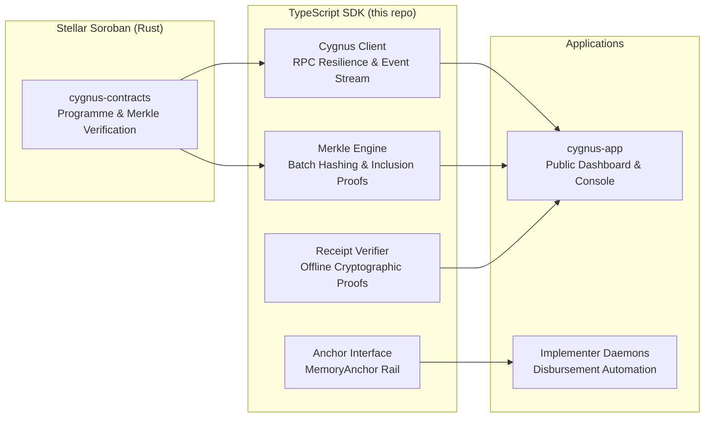
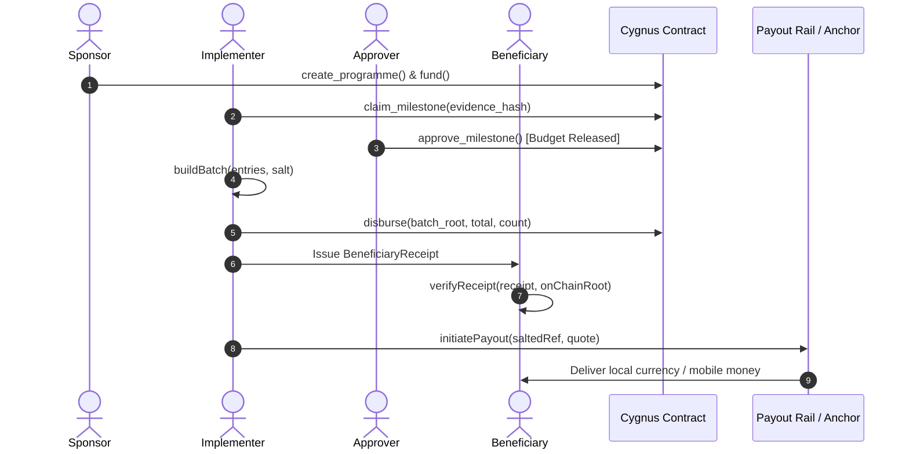

# @cygnus-aid-disbursement/sdk

[](https://github.com/Cygnus-aid-disbursement/cygnus-sdk/actions/workflows/ci.yml)
[](LICENSE)
[](https://www.typescriptlang.org/)
[](https://nodejs.org/)

The official TypeScript SDK for **Cygnus**, a humanitarian aid disbursement protocol on Stellar's Soroban smart contract platform.

Cygnus coordinates the end-to-end lifecycle of conditional aid funding: sponsors fund programmes into non-custodial smart contracts, implementers submit milestone evidence, designated approvers release milestone budgets, and implementers disburse funds to beneficiaries in cryptographically auditable batches that protect beneficiary privacy.

> **Notice**: Unaudited. Testnet only. There is no mainnet deployment or mainnet configuration. Do not use this to move real value.

---

## Architecture & Ecosystem

Dependencies point one way: **contracts &rarr; SDK &rarr; applications**. The SDK vendors contract interface definitions and deployment coordinates; it never imports application code.



---

## Core Protocol Guarantees

1. **What the Chain Proves (and What it Does Not)**:
   The smart contract records that funds moved from the programme escrow according to verified programmatic rules. It proves that money left the contract for a specific Merkle root, entry count, and sum. It **does not** prove that physical aid arrived or that recipients received fiat off-chain.

2. **Beneficiary Privacy by Construction**:
   Individual beneficiary identities and wallet addresses are never published to the ledger. Instead, `buildBatch` salts each beneficiary identifier (`saltRecipientRef`), derives an isolated 32-byte recipient reference, and aggregates payouts into a cryptographic Merkle tree. Only the Merkle root, batch sum, and count appear on-chain.

3. **Portable Offline Receipts**:
   Each beneficiary can be issued a portable `BeneficiaryReceipt` containing their salted leaf and sibling inclusion path. Anyone holding the receipt can verify it offline against the on-chain Merkle root without exposing or enumerating any other recipients in the batch.

---

## Protocol Lifecycle



---

## Features

- **Typed Contract Client**: Complete Soroban RPC bindings with automatic simulation and transaction execution.
- **Environment Factory (`Cygnus.fromEnv`)**: One-line initialization from environment variables with automatic `Keypair` / `basicNodeSigner` setup.
- **Merkle Batch Engine**: Deterministic Merkle tree construction matching `merkle.rs` byte-for-byte, supporting `i128` big-endian two's complement amounts and odd-tail node elevation.
- **Offline Receipts**: Full creation, serialization, and offline mathematical verification of beneficiary receipts (`verifyReceipt`).
- **RPC Resilience**: Automatic exponential backoff with decorrelated full jitter and `AbortSignal` cancellation for transient HTTP 429/5xx errors.
- **Live Event Streaming**: Ledger-aware event subscription loop (`subscribeToEvents`) with cursor persistence.
- **In-Memory Anchor (`MemoryAnchor`)**: Complete reference implementation of the last-mile `Anchor` interface for automated testing and local simulations.
- **Typed Error Taxonomy**: Comprehensive typed exceptions (`CygnusError`, `CygnusContractError` 1–14, `ValidationError`) with detailed diagnostics.
- **Runtime Validation**: Stringent runtime validators for Stellar public keys (`G...`), contract IDs (`C...`), `i128` bounds, and 32-byte binary salts.

---

## Installation

The package is published to GitHub Packages under the organization scope:

```ini
# .npmrc
@cygnus-aid-disbursement:registry=https://npm.pkg.github.com
//npm.pkg.github.com/:_authToken=${GITHUB_TOKEN}
```

```bash
pnpm add @cygnus-aid-disbursement/sdk
# or npm install @cygnus-aid-disbursement/sdk
```

---

## Quickstart

### 1. Configure Environment

Copy `.env.example` to `.env`:

```bash
cp .env.example .env
```

```env
CYGNUS_NETWORK=testnet
CYGNUS_RPC_URL=https://soroban-testnet.stellar.org
CYGNUS_CONTRACT_ID=CBN6MNOWZISG6EXVCUQSGKASFSIBVDBZSVASI6FZYBLBMLHMQWL6SAL7
STELLAR_SECRET=SBXXXXXXXXXXXXXXXXXXXXXXXXXXXXXXXXXXXXXXXXXXXXXXXXXXXXXX
```

### 2. Connect to the Protocol

```typescript
import { Cygnus, normalizeProgramme } from "@cygnus-aid-disbursement/sdk";

// Initialize client automatically from environment variables
const cygnus = Cygnus.fromEnv();

// Query on-chain programme record (programme ID 0)
const rawProgramme = await cygnus.getProgramme(0n);

// Normalize to a dashboard-ready view model
const programme = normalizeProgramme(rawProgramme);
console.log(`Programme: ${programme.metadataHashHex}`);
console.log(`Remaining Funding: ${programme.remainingFunding} stroops`);
console.log(`Status: ${programme.status}`);
```

### 3. Build a Disbursement Batch & Generate Receipts

```typescript
import {
  buildBatch,
  createBatchReceipts,
  verifyReceipt,
  receiptToJson,
} from "@cygnus-aid-disbursement/sdk";
import crypto from "node:crypto";

// 32-byte cryptographically secure per-programme salt
const salt = crypto.randomBytes(32);

// Construct batch entries (references are private and never touch the chain)
const batch = buildBatch(
  [
    { reference: "case-file-1001", amount: 50_0000000n }, // 50 USDC
    { reference: "case-file-1002", amount: 75_0000000n }, // 75 USDC
  ],
  salt,
);

console.log(`Batch Root: ${batch.root.toString("hex")}`);
console.log(`Total Payout: ${batch.total} stroops across ${batch.count} recipients`);

// Generate portable receipts for each beneficiary
const receipts = createBatchReceipts({
  programmeId: 0n,
  batchIndex: 1,
  batch,
  amounts: [50_0000000n, 75_0000000n],
});

// Serialize receipt for a beneficiary
const aliceReceiptJson = receiptToJson(receipts[0]);

// Beneficiary verifies receipt completely offline
const isValid = verifyReceipt(receipts[0], batch.root.toString("hex"));
console.log(`Receipt verified offline: ${isValid}`); // true
```

### 4. Stream Protocol Events

```typescript
import { subscribeToEvents } from "@cygnus-aid-disbursement/sdk";

const subscription = subscribeToEvents(cygnus, {
  startLedger: 1234500,
  pollIntervalMs: 2500,
  onEvent(event) {
    console.log(`Event: ${event.type} in ledger ${event.ledger}`);
    if (event.type === "milestone_approved") {
      console.log(`Milestone ${event.milestoneIndex} approved for programme ${event.programmeId}`);
    }
  },
  onError(err) {
    console.error("Stream polling error:", err);
  },
});

// Later: terminate the polling loop cleanly
// subscription.stop();
```

### 5. Simulate Last-Mile Payouts with `MemoryAnchor`

```typescript
import { MemoryAnchor } from "@cygnus-aid-disbursement/sdk";

const anchor = new MemoryAnchor({
  rate: 1.0,               // 1:1 conversion
  quoteTtlSeconds: 300,    // 5-minute quote validity
  pollsToComplete: 1,      // State progression after 1 poll
});

// Step 1: Request quote for local currency
const quote = await anchor.quote(50_0000000n, "USD");

// Step 2: Initiate payout using salted recipient reference
const payout = await anchor.initiatePayout({
  quoteId: quote.id,
  recipientRef: batch.recipientRefs[0],
  sourceAmount: 50_0000000n,
});

// Step 3: Poll status until funds settle
const status = await anchor.pollStatus(payout.payoutId);
console.log(`Payout status: ${status.state}`); // "completed"
```

---

## Error Handling

All SDK exceptions inherit from [`CygnusError`](src/errors.ts). Application errors returned by the Soroban smart contract are wrapped in typed subclasses of [`CygnusContractError`](src/errors.ts):

```typescript
import {
  CygnusContractError,
  MilestoneNotClaimableError,
  InsufficientReleasedError,
} from "@cygnus-aid-disbursement/sdk";

try {
  await cygnus.claimMilestone(0n, 1);
} catch (error) {
  if (error instanceof MilestoneNotClaimableError) {
    console.error("Milestone is not currently in claimable status.");
  } else if (error instanceof InsufficientReleasedError) {
    console.error("Disbursement exceeds approved milestone funding.");
  } else if (error instanceof CygnusContractError) {
    console.error(`Contract error [${error.code}]: ${error.codeName}`);
  }
}
```

---

## Protocol Compatibility

| SDK Version | Contract Interface Version | Stellar Testnet | Mainnet |
|:---:|:---:|:---:|:---:|
| `0.1.x` | `v0.1.0` | Supported | No |

---

## Development & Testing

Ensure Node.js 20+ and pnpm are installed.

```bash
# Install dependencies
pnpm install

# Run complete Vitest suite (100% offline, mock RPC and unit tests)
pnpm test

# Verify TypeScript types
pnpm typecheck

# Check code formatting
pnpm lint

# Compile to dist/
pnpm build
```

To run the on-chain Testnet integration cross-check:

```bash
STELLAR_SECRET="S..." pnpm test test/integration.test.ts
```

---

## Community & Contributing

We welcome contributions! Please review:
- [CONTRIBUTING.md](CONTRIBUTING.md) — Development workflow, coding style, and PR guidelines.
- [CODE_OF_CONDUCT.md](CODE_OF_CONDUCT.md) — Contributor Covenant v2.1 standards.
- [SECURITY.md](SECURITY.md) — Responsible vulnerability disclosure policy.

---

## License

Licensed under the Apache License, Version 2.0. See [LICENSE](LICENSE) for details.
